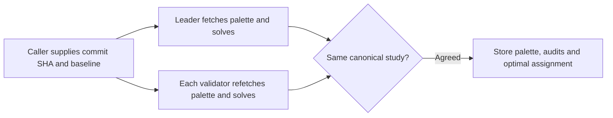

# ContrastAssign

**A GenLayer contract for finding the smallest text-contrast repair in a shared design palette.**

[](https://github.com/mohammadisina1988-jpg/contrast-assign/actions/workflows/checks.yml)
[Contract source](contracts/contrast_assign.py) · [StudioNet explorer](https://explorer-studio.genlayer.com/address/0x2bA9e2F9717996d0A9A71D401F04B87f719baeBC) · [Proof JSON](proofs/studionet.json) · [Submission](SUBMISSION.md)

Design-system teams can publish a reproducible answer to a concrete question. Given six palette slots already assigned to interface roles, how many roles must change for body text, links, and badge text to clear a 4.5:1 contrast threshold? Other builders can consume the agreed assignment and its pair-by-pair audit from a contract view.

## The example

The input baseline `012345` maps each role to the slot in its column. With the [pinned Open Color palette](https://github.com/yeun/open-color/blob/3a716ee1f5ff5456db33cb8a6e964afdca1e7bc3/open-color.json), the minimum repair swaps the panel and link colors. The resulting baseline `032145` passes all five configured checks.

| Interface role | Slot in `012345` | Slot in `032145` |
| --- | --- | --- |
| Canvas | `0` gray 0 · `#f8f9fa` | `0` gray 0 · `#f8f9fa` |
| Panel | `1` gray 9 · `#212529` | **`3` cyan 1 · `#c5f6fa`** |
| Body text | `2` blue 9 · `#1864ab` | `2` blue 9 · `#1864ab` |
| Link text | `3` cyan 1 · `#c5f6fa` | **`1` gray 9 · `#212529`** |
| Badge background | `4` orange 1 · `#ffe8cc` | `4` orange 1 · `#ffe8cc` |
| Badge text | `5` violet 9 · `#5f3dc4` | `5` violet 9 · `#5f3dc4` |

## GenLayer consensus



Every observer fetches the source from the fixed upstream repository inside `gl.vm.run_nondet_unsafe`. It checks the HTTP response and extracts six RGB values into a canonical slot order. A validator independently reruns acquisition and optimization, then compares the full normalized palette, all five original verdicts, the repaired assignment, move count, and all five repaired verdicts. A changed shade invalidates equivalence even if the optimizer would choose the same slots. Fetch or parse failures leave the study absent.

The optimizer checks body text and link text against both canvas and panel, and badge text against its badge background. It enumerates the 720 bijections, minimizing the number of changed roles. Ties use lexicographic slot order. Integer luminance bounds implement the [WCAG 2.2 text-contrast criterion](https://www.w3.org/TR/WCAG22/#contrast-minimum). A lower bound at or above `9/2` passes. An upper bound below `9/2` fails. Intervals that cross the threshold are indeterminate and ineligible for an assignment. The result applies to the five listed pairs of opaque sRGB colors.

## Read or publish

| Method | Result |
| --- | --- |
| `publish(revision, baseline)` | Permissionless. Computes and records an immutable study, then returns `revision:baseline`. Repeating the same inputs returns that key. |
| `get_study(revision, baseline)` | Returns the study or `null`. `status` is `assigned` or `no_certified_assignment`. |

`revision` is a lowercase 40-character upstream commit SHA. `baseline` is a six-character permutation of `012345` in the role order shown above. The contract stores one canonical study per input pair. In each audit, entries are `[foreground_role, background_role, verdict, contrast_lower_milli]`. Divide the last field by `1000` to read the conservative contrast ratio.

All observers rely on availability and integrity of the same upstream publisher. The pinned revision gives observers a stable target, and independent agreement guards against inconsistent fetched values. Different commit SHAs and baselines can coexist in storage.

## StudioNet proof

| Finalized transaction | Observed result | Agree votes |
| --- | --- | --- |
| [Deploy](https://explorer-studio.genlayer.com/tx/0xe46ebbdb2c53733a680438ad219a7ca25b78342d41b0abf7dbb51b294e03c499) | StudioNet contract created | 3 / 5 |
| [Publish `012345`](https://explorer-studio.genlayer.com/tx/0x37d3dbb8bad2c5b90ceedd76fcc2cbb5fad79470d36833e572c530e07bcef035) | Two moves. All five repaired pairs pass, with a minimum contrast lower bound of 5.199:1. | 3 / 5 |
| [Publish `032145`](https://explorer-studio.genlayer.com/tx/0xb72d37a99665e76d64a33629072467914f9639744f019ee526849faeac22614e) | Zero moves. All five pairs pass. | 4 / 5 |

Replay the proof against the public RPC with Node.js 22 or newer. The verifier checks deployed source bytes, finalized receipts, decoded return keys, validator votes, and storage readback against an independent reference solver.

```sh
npm ci
npm run verify
```

## Local checks

```sh
python -m pip install -r requirements-dev.txt
genvm-lint download --version v0.2.16
genvm-lint check contracts/contrast_assign.py
python -m pytest tests/direct -q
```

The tests cover minimum repair against an independent exhaustive reference, zero moves, equivalent encodings, a changed source, infeasibility, malformed evidence, and both sides of the contrast threshold. The bundled Open Color fixture is distributed under [its upstream MIT license](fixtures/OPEN-COLOR-LICENSE).
